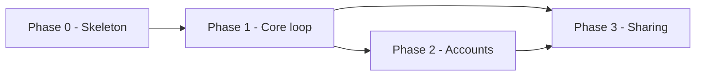

# Phasing rules

## The vertical slice rule

A phase ends with something a person can *use or watch*. If a phase's deliverable is a layer
("the data model", "the API"), it is not a phase — it is a task inside one.

Test: can you write the Demo sentence — *"At the end of this phase we can show X doing Y"* — without
using the words "infrastructure", "foundation", or "groundwork"? If not, re-cut the phase.

## Phase 0 — walking skeleton, always

The thinnest possible end-to-end path through the real stack: one route, one real query against a
real database, one passing test, deployed to the real target. No features.

Why it is never skipped: it converts every stack assumption in SPECS.md from belief into fact while
the cost of being wrong is one afternoon. Discovering the ORM does not work with your host in
Phase 3 costs a rewrite.

Exit criteria are always roughly: it runs locally with one command · it is deployed and reachable ·
CI is green on a real test · **the `SPECS.md` performance budget is measured on the real target and
the numbers recorded** · a new contributor can get from clone to running in under 15 minutes.

Mark the criteria only a real release can prove with ` — at release`, e.g.
`- [ ] It is deployed and reachable — at release`. `/setup` leaves those open when it sets the phase
`verified`; `/ship` checks and ticks them after the deploy.

That budget measurement is the point of doing this early. A skeleton proves the stack works;
measuring proves it works fast enough, while changing course still costs an afternoon rather than a
rewrite. See `.claude/skills/shared/quality-bar.md`.

## Ordering

1. **Dependency** — what must exist first, actually. Not what feels foundational.
2. **Risk** — the assumption that could kill the project goes in the earliest phase that can test it.
   A phased plan whose riskiest bet sits in Phase 4 is a plan to waste three phases.
3. **Learning** — prefer the phase whose outcome changes what you would do next.
4. **Momentum** — only as a tiebreaker.

Never order by what is easiest, and never order by what is most fun.

## Anatomy of a phase

| Field | Rule |
|---|---|
| **Goal** | One sentence, an outcome not an activity. "Users can save and reopen a document", not "build persistence". |
| **Epics** | Wikilinks to `.idea/epics/`. 2-5 per phase. |
| **Exit criteria** | `- [ ]` items a *different person* could verify without asking you. No "works well". |
| **Demo** | The sentence you would say while screen-sharing. |
| **Risks** | What could make this phase overrun, and the early warning sign for each. |
| **Non-goals** | Named explicitly. This is what stops scope creep mid-phase. |

## Sizing

3-6 phases. Each 1-3 weeks of the actual available effort — ask what that is rather than assuming
full time. A phase you cannot describe in one sentence is two phases.

## Spikes

Any committed idea with `confidence` ≤ 2 becomes a timeboxed spike, sequenced *before* anything that
depends on it. A spike's exit criterion is a written decision (an ADR), never a feature. Give it an
explicit timebox and an explicit fallback if it fails.

## Dependency graph

Put one in ROADMAP.md so the critical path is visible rather than implied:

## Re-shaping

When a phase completes or reality intervenes: never rewrite history. Mark phases `done` or `cut`
with a dated note on why, append new phases, and keep the numbering stable so links survive.
