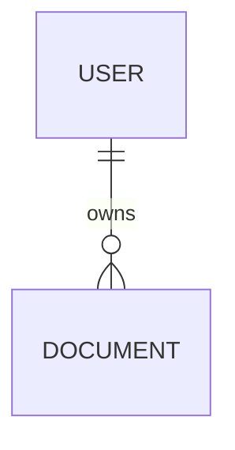
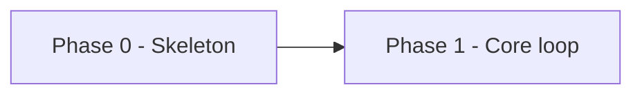

# Shape output templates

Formatting rules live in `.claude/skills/shared/vault-contract.md`.

## `.idea/SPECS.md`

```markdown
---
title: SPECS
created: 2026-08-30
updated: 2026-08-30
tags: [specs, project]
status: draft
---

# SPECS

> [!abstract] In one sentence
> What this is and who it is for.

## Identity

| | |
|---|---|
| Name | |
| One-liner | |
| Repo / package | |
| License | |

## Users and job

Who uses this and what job they hire it for. Derived from [[Theme]] notes.

## Success

The one metric that says it worked, and the number that counts as working.

## Scope — v1

- [[Epic A]]
- [[Epic B]]

## Non-goals

Named explicitly. Each with the reason it is out.

## Stack

| Layer | Choice | Why | Alternatives considered |
|---|---|---|---|
| Language / runtime | | | |
| Framework | | | |
| Package manager | | | |
| Database | | | |
| Data access / migrations | | | |
| Auth | | | |
| Styling / UI | | | |
| Testing | | | |
| Lint / format / typecheck | | | |
| CI | | | |
| Hosting / deploy | | | |
| Secrets / env | | | |

Pin versions where the choice is version-sensitive. `setup` consumes this table literally.

## Data model sketch



Enough to start migrations, not a final schema.

## Decisions

| # | Decision | Choice | Rationale | ADR |
|---|---|---|---|---|
| 1 | | | | [[ADR-0001 ...]] |

## Open questions

> [!question]
> - ...

## Traceability

Which ideas became which epics: [[Idea A]] → [[Epic A]] → Phase 1.

## Setup log

Appended by `setup` after each run, dated.
```

## `.idea/ROADMAP.md`

```markdown
---
title: ROADMAP
created: 2026-08-30
updated: 2026-08-30
tags: [roadmap, project]
status: draft
---

# ROADMAP

> [!abstract] Shape of the plan
> N phases. The riskiest assumption is tested in Phase X.

| Phase | Goal | Exit | Status |
|---|---|---|---|
| 0 | Walking skeleton | Deployed, CI green | planned |
| 1 | | | planned |



---

## Phase 0 — Walking skeleton

**Goal.** One sentence, an outcome.

**Epics.** [[Epic A]] · [[Epic B]]

**Exit criteria**
- [ ] Verifiable by someone who did not write it.

**Demo.** The sentence you say while screen-sharing.

> [!warning] Risks
> - Risk — and its early warning sign.

**Non-goals.** Named explicitly.

---

## Phase 1 — <Name>

Same shape. Repeat per phase.
```

## `.idea/epics/<Epic Title>.md`

```markdown
---
title: <Epic Title>
created: 2026-08-30
updated: 2026-08-30
tags: [epic, <theme-tag>]
status: planned
theme: <Theme Title>
phase: 1
sources: [Idea A, Idea B]
---

# <Epic Title>

## Outcome

What is observably true when this is done.

## Acceptance criteria

Each carries a permanent task reference id as a block ref. Assign once, never reassign.

- [ ] ... ^tsk-7f3a21
- [ ] ... ^tsk-9c04e8

## Approach

The intended shape of the work. Two or three sentences.

## Dependencies

- Blocked by: [[Other Epic]]

> [!warning] Risks
> - ...

## Related

- Theme: [[<Theme Title>]]
- From: [[Idea A]] · [[Idea B]]
- Phase: [[ROADMAP]]
```

## `.idea/decisions/ADR-0001 <Decision>.md`

```markdown
---
title: ADR-0001 <Decision>
created: 2026-08-30
updated: 2026-08-30
tags: [adr, decision]
status: accepted
decision: <the choice, in five words>
supersedes:
superseded_by:
---

# ADR-0001 <Decision>

## Context

What forced a choice. Link the ideas and constraints: [[Idea A]].

## Options

| Option | Pros | Cons |
|---|---|---|

## Decision

What was chosen, and by whom.

## Consequences

What this makes easy, what it makes hard, and what would make us revisit it.
```
