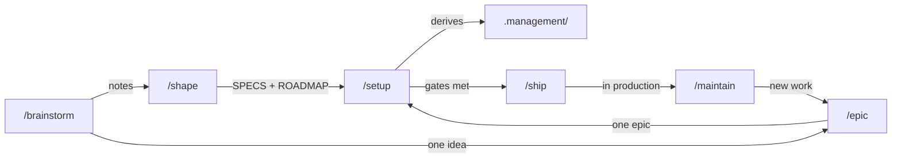

# The Idea Vault

This folder is the **thinking layer** of this project. The repo records what was built; `.idea/`
records what we intended, what we considered, and why we chose one thing over another.

Open it as an [Obsidian](https://obsidian.md) vault — point Obsidian at **this folder directly**,
not at the project root. Obsidian ignores any folder whose name starts with a dot, so `.idea/` is
invisible if it sits inside a vault; as a vault *root* it works normally, because the rule applies to
a vault's contents rather than to the root itself. `.management/` is a second, separate vault for the
same reason, and wikilinks do not cross between the two.

Every note is plain Markdown with YAML frontmatter and `[[wikilinks]]`, so it also reads fine on
GitHub or in any editor.

## The pipeline

| Command | Reads | Writes |
|---|---|---|
| `/brainstorm` | the whole vault, the repo | `notes/`, `themes/`, `sessions/`, `INDEX.md` |
| `/shape` | `notes/`, `themes/`, intent ledger | `SPECS.md`, `ROADMAP.md`, `epics/`, `decisions/` |
| `/epic` | `SPECS.md`, `ROADMAP.md`, `epics/` | one `epics/` note and its tasks |
| `/setup` | `SPECS.md`, `ROADMAP.md`, `epics/` | the actual codebase, `.management/`, plus status back into the vault |
| `/ship` | `ROADMAP.md`, readiness gates | `CHANGELOG.md`, phase status, release ADRs |
| `/maintain` | `decisions/`, the repo | `CHANGELOG.md`, superseding ADRs |
| `/decide` | `SPECS.md`, `decisions/` | one `decisions/` ADR |

Each stage refuses to run on thin input and points at the previous one, so the chain stays honest.

`.management/` sits downstream of all of them: this folder records what we *intend*, `.management/`
records how it is actually *going*. It is regenerated from `.idea/`, never edited back into it.

The `project-manager` agent watches both. It may propose epics at `status: suggested` and mark tasks
done from commit evidence — always with a note — but it may never edit the plan itself.

## What lives where

| Path | Holds | Rule |
|---|---|---|
| `INDEX.md` | Root map of content | Regenerated, never appended to |
| `SPECS.md` | The contract: scope, stack, decisions | `/setup` consumes its stack table literally |
| `ROADMAP.md` | Phases with goals and exit criteria | Every phase is a runnable vertical slice |
| `themes/` | One map per theme | The grouping layer — themes group by *problem*, not technology |
| `notes/` | Atomic ideas, scored | Exactly one idea per file |
| `epics/` | Deliverable work, 1-5 days each | Links up to ideas, down to a phase. `status: suggested` means proposed by the agent, not yet agreed |
| `decisions/` | ADRs | One consequential decision per file |
| `sessions/` | Dated brainstorm logs | Includes the intent ledger |
| `assets/` | Images, diagrams, exports | |

## How ideas are organised

Ideas carry scores in frontmatter so they can be sorted and grouped rather than argued about
from memory:

- **`horizon`** — `now` / `next` / `later` / `someday`
- **`impact` `effort` `confidence`** — 1-5 each, kept as a triple and never averaged into one
  number. The shape of the triple is the information: high impact with low confidence is a *spike*,
  not a task.
- **`status`** — `seed` → `exploring` → `promising` → `committed`, or `parked` / `superseded`.

## Traceability

Every deliverable traces back to an idea, and every committed idea traces forward to shipped work:

> [!abstract] The chain
> `notes/Idea.md` → `epics/Epic.md` (`sources:`) → `ROADMAP.md` phase → code

`/shape` verifies this chain in both directions before it finishes. If you ever wonder *why does
this code exist*, follow the links back.

## Two rules that matter most

> [!warning] Nothing is deleted, nothing is overwritten
> A rejected idea gets `status: superseded` and a link to whatever replaced it. The record of what
> we decided against is worth as much as the record of what we chose — it stops the same idea being
> re-litigated in six months.

> [!warning] No orphans
> Every note is linked from its theme and from `INDEX.md` in the same edit that creates it.
> An unlinked note is invisible in the graph, which means it does not exist.

## Conventions

Filenames are `Title Case With Spaces.md` and must match the note's `title`, since wikilinks
resolve by filename. The characters `# ^ [ ] | : / \ * ? " < >` never appear in a filename.
Inline tags are `#kebab-case` and never start a line, because Obsidian would parse that as a heading.

The full contract is at [.claude/skills/shared/vault-contract.md](../.claude/skills/shared/vault-contract.md).

## Starting from scratch

Run `/brainstorm` and describe what you are thinking about. Everything else follows from that.
