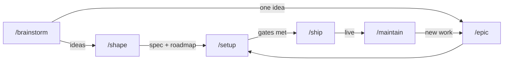

<div align="center">

# 建 て る

### tateru

<sub>Japanese, “to build.”</sub>

**Stop vibe-coding. Start shipping.**

A [Claude Code](https://claude.com/claude-code) workflow that walks a project from *“I had a thought in the shower”* to something live — and then keeps an eye on it.

[](LICENSE)
[](https://claude.com/claude-code)
[](#faq)
[](#contributing)
[](https://buymeacoffee.com/jamesm.dev)

</div>

---

Most AI coding sessions start with a vague prompt and end with a folder of confident-looking code nobody can explain three weeks later. No spec. No decisions written down. No idea which half is tested.

**tateru is eight slash commands and some stubborn rules that get in the way of that.** Spec-driven development for AI agents: it asks questions before writing code, records *why* you chose things, refuses to call a phase done without running the tests, and gives you a project board that reads from your actual repo instead of a spreadsheet nobody updates.

Works with any language or framework. The workflow is the product; the code stays yours.

---

## Quick start

**You need:** [Claude Code](https://claude.com/claude-code) and a folder. That's it.

```bash
git clone https://github.com/jamesm-dev/tateru.dev my-project
cd my-project
claude
```

Then, in the session:

```
/hooks          # once, so the hooks load
/brainstorm     # describe the thing you're thinking about
```

Follow where it takes you:

```
/brainstorm  →  /shape  →  /setup  →  /ship
   ideas         a plan     it runs    it's live
```

Your code lands in **`app/`**. Everything else in the repo is the workflow — rename the folder, rewrite the root README, and it's your project.

Never seen this repo before? Run **`/explain`** and it walks you through every command like you're new. Because in six months, you are.

---

## The pipeline



Idea → development → production → maintenance. The whole life of a project, not just the fun part at the start.

| Command | What it does |
|---|---|
| **`/brainstorm`** | Generates 8–12 genuinely different ideas *before* judging any of them. Groups them into themes, scores each, files every one as its own note. |
| **`/shape`** | Ideas → a spec and a phased roadmap. Breaks work into days-sized epics and surfaces the boring stuff you forgot: auth, migrations, deploys. |
| **`/setup`** | Builds it. One phase at a time, verified against that phase's exit criteria, showing you real command output. |
| **`/ship`** | Walks seven readiness gates, then releases. Won't let an unmet gate slide past quietly. |
| **`/maintain`** | For when it's live and slowly rotting. Dependencies, silent tests, decisions reality has overtaken. |
| **`/epic`** | New idea halfway through? Adds one epic and its tasks without re-planning everything. |
| **`/decide`** | Records an architecture decision as a numbered ADR, so future-you knows why. |
| **`/explain`** | Explains any of the above from scratch, in plain words. |

Each stage refuses to run on thin input and points back at the previous one. You can't accidentally skip from a hunch to a half-built app.

---

## How this is different

Spec-driven development is a crowded field, and the good tools are genuinely good.
[Spec Kit](https://github.com/github/spec-kit), [OpenSpec](https://github.com/Fission-AI/OpenSpec),
[BMAD-METHOD](https://github.com/bmad-code-org/BMAD-METHOD) and
[Superpowers](https://github.com/obra/superpowers) all turn a described feature into working code.
If that is what you need, use one of them — they do it well.

tateru starts earlier and stops later.

> **Spec Kit writes your spec. tateru runs your project** — from the first vague idea to the
> maintenance six months after launch.

| | Most spec-driven tools | tateru |
|---|---|---|
| **Starts from** | a feature you can already describe | a hunch you can't. `/brainstorm` generates and scores 8–12 options before you commit to one |
| **Ends at** | "implemented" | shipped through readiness gates — then `/maintain` for the rot that arrives afterwards |
| **Its board tracks** | Claude Code sessions and agent runs | acceptance criteria from your roadmap. The plan, not the tooling |
| **Sequencing** | tasks in dependency order | phases in **risk** order, each a vertical slice, Phase 0 a deployed walking skeleton |
| **Its agent** | writes code for you | audits you. It can suggest, and it cannot edit the plan or tick a criterion |

And one thing that is honestly *not* a differentiator: plenty of projects point an AI agent at an
Obsidian vault. What is different here is what the vault holds — not general notes, but the spec,
the roadmap, the epics and the ADRs that `/setup` builds from and `/ship` checks against.

---

## The opinionated bits

These will occasionally annoy you. That's the point.

🦴 **Phase 0 is always a walking skeleton.** One route, one real query, one passing test, deployed. No features. It turns every assumption about your stack into a fact while being wrong still costs an afternoon instead of a rewrite.

🎯 **Phases are ordered by risk, not by ease.** The assumption most likely to kill the project gets tested first. A plan whose riskiest bet sits in Phase 4 is a plan to waste three phases.

🗑️ **Nothing is ever deleted.** A rejected idea gets marked superseded with a link to whatever replaced it. What you decided *against* is worth as much as what you chose — it's what stops the same argument in March.

✅ **Verification means running the thing.** Install, lint, typecheck, test, build, with the actual output. A phase reported done with a failing check is worse than an honest partial.

📏 **Performance is a number in the spec, not a hope.** `/shape` writes a budget — time to interactive on a real device, a bundle ceiling. Phase 0 *measures* it. Every phase after re-checks it. A missed budget gets reported as missed.

🚫 **Nothing gets invented.** Not a version number, not a CLI flag, not a secret, not a task nobody wrote down.

---

## Where things live

```
.idea/          Intent — what you're building and why.
                Ideas, themes, the spec, the roadmap, epics, ADRs.

.management/    State — how it's actually going.
                Board, progress, blockers, changelog.

.claude/        The machinery. Commands, skills, hooks, the PM agent.

app/            Your actual project. Everything /setup scaffolds lands here.
```

The root belongs to the workflow; **`app/` is yours.** That split is why cloning this, building in it, and still having the workflow intact afterwards all work at once.

`.idea/` and `.management/` are each [Obsidian](https://obsidian.md) vaults — open either directly and your whole project history is a linked graph you can wander through. Real frontmatter, real wikilinks, real callouts. **Three hooks** keep it that way, including one that audits every note at session start and catches files you edited by hand.

---

## The dashboard

`/setup` offers to build a project board at `/management`, using **your project's own theme and components** — not a bolted-on second design system.

- **Board** — draggable task cards with assignees, points, priority, and estimate vs. actual. Colour-coded by epic.
- **Specs** — your epics and everything inside them.
- **Team** — who's on what, and their load in points.
- **Status** — deployment readiness as a gate checklist, what's blocking you, sprints, and phases that advance themselves once the work is done or parked.

Structure comes from `.idea/`. Assignees and effort live in a database the dashboard owns. PR and test data is synced in, always stamped with *when*. Nothing pretends to be fresher than it is — and there are **no burndown charts, no velocity, no forecast dates** invented from three sprints of noise.

**Dev-only by default**, because a public roadmap of everything you haven't built yet should be a choice.

---

## The agent

`/setup` installs a `project-manager` agent that judges whether the project is actually succeeding, and keeps it moving. Every claim it makes is backed by a file on disk; when it doesn't know, it says what's missing instead of guessing.

It has exactly **two** powers, both of which leave a trail:

- **Suggests epics** for gaps it finds. They land at `status: suggested`, belong to no phase, and count toward nothing until you accept one.
- **Marks tasks done from commits** — with a note explaining why and the SHAs it relied on. Shows as `done · unconfirmed` until a human agrees.

It cannot edit the plan, tick an exit criterion, or deploy. An overseer that can quietly rewrite what it audits isn't an overseer.

---

## FAQ

**Does it work with my stack?**
Yes. tateru never picks your language — `/shape` interviews you, records the choice with its reasoning, and `/setup` uses the ecosystem's own scaffolder. Node, Python, Go, Rust, whatever you like.

**Do I need Obsidian?**
No. The notes are plain Markdown and read fine on GitHub or in your editor. Obsidian just makes the graph pretty.

**Is this another AI that writes the whole app for me?**
No. It asks questions first, and it will tell you when it thinks you're wrong. That feels slow right up until the moment it doesn't.

**What actually gets deployed?**
Only your app's build output. `.idea/` and `.management/` are repository content, never published — and `/ship` checks whether your remote is public before the first release, because the plan lives in the repo.

**Optional extra:** the GitHub MCP adds pull request status to the dashboard. Everything else works without it.

```bash
claude mcp add github -s user -- npx -y @modelcontextprotocol/server-github
```

---

## Is this for you?

**Probably yes** if you start more projects than you finish, or you've reopened your own repo and had no idea why past-you chose Postgres.

**Probably not** if you want to type one prompt and get an app. This one asks questions first.

---

## Contributing

Issues and PRs welcome. The workflow is opinionated on purpose — if a rule annoys you, open an issue and say why. The rules that survive an argument are the good ones.

## Author

Built by **James Malatabon** — because I kept starting projects and losing the thread of why.

- Web — [jamesm-dev.com](https://jamesm-dev.com)
- Email — [jamesmalatabon@gmail.com](mailto:jamesmalatabon@gmail.com)
- Coffee — [buymeacoffee.com/jamesm.dev](https://buymeacoffee.com/jamesm.dev)

If tateru saved you an afternoon of "wait, why did I build it like this", a coffee is a lovely way
to say so. A star works too, and is free.

## License

[MIT](LICENSE) (c) James Malatabon. Take it, fork it, make it yours.

---

<sub>**Keywords:** claude code · ai project management · brainstorm to production · roadmap kanban board · deployment readiness · post-launch maintenance · architecture decision records (ADR) · product roadmap · sprint planning · release management · software development lifecycle · spec-driven development · ai agents · slash commands · developer productivity · developer tools · obsidian vault · project boilerplate<br />
Built and maintained by <a href="https://jamesm-dev.com">James Malatabon</a>.</sub>
