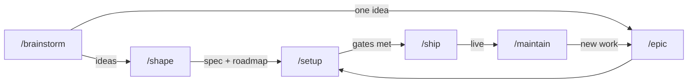

# tateru

**A Claude Code workflow that takes a project from "I had a thought in the shower" to something that actually ships — and then keeps an eye on it.**

Most AI coding sessions start with a vague prompt and end with a folder of confident-looking code nobody can explain three weeks later. `tateru` puts a handful of commands and some stubborn rules in the way of that.

> 建てる *(tateru)* — Japanese, "to build."

---

## The pipeline



Idea, development, production, maintenance — the whole life of a project, not just the fun part at the start.

| Command | What it does |
|---|---|
| **`/brainstorm`** | Generates 8–12 genuinely different ideas before judging any of them, groups them into themes, scores each, and files every one as its own note. |
| **`/shape`** | Turns ideas into a spec and a phased roadmap. Breaks each idea into work you can finish in days, and surfaces the boring stuff your idea notes never mention — auth, migrations, deploys. |
| **`/epic`** | Had a new idea halfway through? This adds one epic and its tasks without re-planning everything. |
| **`/setup`** | Builds it. One phase at a time, verifying against that phase's exit criteria and showing you the real command output. |
| **`/ship`** | Walks seven readiness gates, then releases. Won't let an unmet gate pass quietly. |
| **`/maintain`** | For when it's live and slowly rotting. Dependencies, silent tests, decisions reality has overtaken. |
| **`/decide`** | Records an architecture decision, so future-you knows why. |
| **`/explain`** | Explains any of the above like you have never seen this repo. Because in six months, you haven't. |

Each stage refuses to run on thin input and points back at the previous one. You cannot accidentally skip from a hunch to a half-built app.

---

## The opinionated bits

These are the parts that make it work. They will occasionally annoy you. That's the idea.

**Phase 0 is always a walking skeleton.** One route, one real database query, one passing test, deployed. No features. It turns every assumption about your stack into a fact while being wrong still costs an afternoon instead of a rewrite.

**Phases are ordered by risk, not by ease.** The assumption most likely to kill the project gets tested first. A plan whose riskiest bet sits in Phase 4 is a plan to waste three phases.

**Nothing is ever deleted.** A rejected idea gets marked superseded with a link to whatever replaced it. The record of what you decided *against* is worth as much as what you chose — it's what stops the same argument in March.

**Verification means running the thing.** Install, lint, typecheck, test, build — with the actual output. A phase reported as done with a failing check is worse than an honest partial.

**Quality wins the tiebreak, and the bill is itemised.** When the convenient choice and the good one disagree, the workflow takes the good one and tells you what it cost — in setup time, in extra concepts, in a slower first commit. It refuses to let a passing "we could just..." quietly become the architecture. It also won't let you gild a form with four fields: the bar is the best result for what you are actually building.

**Performance is a number in the spec, not a hope.** `/shape` writes a budget — time to interactive on a real device, the p95 of your most frequent interaction, a bundle ceiling. Phase 0 measures it while changing your mind still costs an afternoon, and every phase after re-checks it. A missed budget gets reported as missed.

**Nothing gets invented.** Not a version number, not a CLI flag, not a secret, not a task nobody wrote down.

---

## Where things live

```
.idea/          Intent. What you're building and why.
                Ideas, themes, the spec, the roadmap, epics, decisions.

.management/    State. How it's actually going.
                Board, progress, blockers, changelog, dashboard design.

.claude/        The machinery. Commands, skills, hooks, and the PM agent.
                skills/shared/ holds the two contracts every skill obeys:
                vault-contract.md (how notes are written) and
                quality-bar.md (how stack and structure get decided).
```

Both folders are [Obsidian](https://obsidian.md) vaults — open either one directly and the whole thing is a linked graph you can wander through. Every note has proper frontmatter, real wikilinks, and callouts. Three hooks make sure it stays that way, including one that audits every note at session start and catches files you edited by hand.

---

## The dashboard

`/setup` offers to build a project management dashboard at `/management`, using **your project's own theme and components** — not a bolted-on second design system.

Four sections behind a sidebar:

- **Board** — task cards with assignees, points, and estimate against actual. Create tasks and attach them to an epic.
- **Specs** — your epics, and what's inside each one.
- **Team** — who's on what, and what they've shipped.
- **Status** — deployment readiness as a gate checklist, a delivery log that counts untracked commits too, sprints, and a risk list built from rules that fire on facts. No burndown charts. No velocity. No forecast dates pulled from three sprints of data.

Structure comes from `.idea/`. Assignees and effort live in a standalone database the dashboard owns. PR status and test results are synced in, always stamped with when. Nothing pretends to be fresher than it is.

It's **dev-only by default**, because a public roadmap of everything you haven't built yet is a choice, not an accident.

---

## Setup

**You need:** [Claude Code](https://claude.com/claude-code), and a folder.

```bash
git clone <this-repo> my-project
cd my-project
claude
```

Then, in the session:

```
/hooks          # once, so the hooks load
/brainstorm     # describe what you're thinking about
```

Follow where it goes. `/shape` when you have ideas worth planning, `/setup` when you have a plan worth building, `/ship` when the gates go green.

### Optional, but recommended

| | For | Install |
|---|---|---|
| **GitHub MCP** | Pull request status in the dashboard. Everything else works without it. | `claude mcp add github -s user -- npx -y @modelcontextprotocol/server-github` |

`/setup` tells you at session start if either is missing, with the exact command. It won't quietly work around them.

---

## The agent

`/setup` also installs a `project-manager` agent that judges whether the project is actually succeeding — across idea, development, production, and maintenance — and keeps it moving toward deployment.

Every claim it makes is backed by a file on disk, and when it doesn't know, it says what's missing instead of guessing.

It has exactly **two** powers, both of which leave a trail:

- **Suggests epics** for gaps it finds — an untested area, an exit criterion nothing covers. They land at `status: suggested`, belong to no phase, and count toward nothing until you accept one with `/epic accept`. Or delete it. It's a suggestion.
- **Marks tasks done from commits** — but only with a note explaining why, the commit SHAs it relied on, and the PR if there is one. It shows as `done · unconfirmed` until a human agrees.

It cannot edit the plan, tick an exit criterion, or deploy anything. An overseer that can quietly rewrite what it audits isn't an overseer.

---

## Is this for you?

**Probably yes** if you start more projects than you finish, or you've come back to your own repo and had no idea why past-you chose Postgres.

**Probably not** if you want to type one prompt and get an app. This asks you questions first. That's the whole point, and it will feel slow right up until the moment it doesn't.

---

## License

MIT. Take it, fork it, make it yours.
